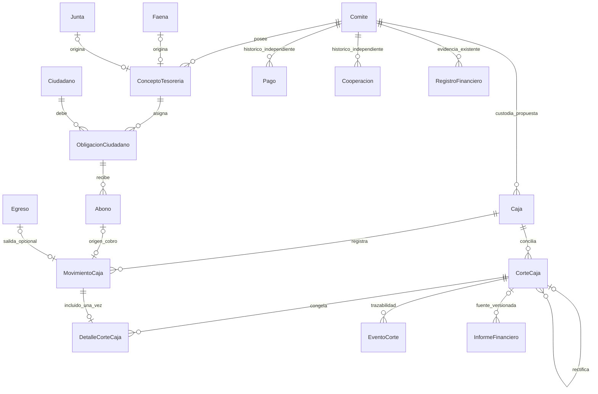

# Arquitectura y diccionario preliminar de datos

Todo lo descrito aquí es diseño candidato. No se han creado modelos Django ni migraciones.

## Reutilización antes de nuevas tablas

Las fases de indicadores/reportes reutilizan ConceptoTesoreria, ObligacionCiudadano, Abono, Pago, Cooperacion, RegistroFinanciero y eventos. No requieren duplicar obligaciones, ingresos o catálogos de categorías. No crear Caja o Egreso únicamente para dibujar gráficas.

Para cortes reales faltan hechos que esas entidades no representan: unidad de custodia, medio de pago, entradas/salidas no asociadas a obligaciones, apertura, conteo, quién revisó, manifestación de inclusión y cierre inmutable. Es la justificación de las entidades propuestas a continuación.

## Diagrama entidad relación

El diagrama es lógico: Pago/Cooperacion permanecen separados; no hay FK de estos modelos a Abono. Los dos vínculos de evento se validarán como mutuamente excluyentes y coherentes con origen. Un Abono anterior puede no tener MovimientoCaja porque su medio/custodia son desconocidos. No asumir que ya tiene movimiento con valor cero.

## Entidades candidatas y consecuencias

### Caja

- **Responsabilidad:** unidad de custodia/recaudación de un comité. MVP: una caja pertenece a un solo comité; `manzana` opcional restringe una caja exclusivamente territorial. Una cuenta bancaria puede ser un destino documentado sin integrar banca.
- **Campos:** UUID, código, nombre, comite FK PROTECT, manzana FK PROTECT nullable, activa, fecha_inicio_control, creado_por y timestamps. Sin saldo mutable en la fila: el saldo procede de apertura y movimientos.
- **Relaciones:** movimientos y cortes. La caja central no mezcla comités: Secretaría puede operar varias cajas y ver consolidado autorizado. La manzana de una caja no se deduce del domicilio del cajero.
- **Restricciones:** código único por instancia; no modificar comité/manzana después de movimientos; desactivar sin borrar; no permitir captura posterior a desactivación. Comité/territorio compatibles con el concepto del cobro.
- **Índices:** único código, `(comite_id, activa)`, `(manzana_id, activa)` si lo justifican consultas.
- **Validaciones:** identidad activa, capacidad y ámbito del recurso en cada movimiento. Una caja territorial no admite cobros GENERAL aunque el ciudadano sea local.
- **Permisos:** usar responsabilidades existentes más capacidades específicas; Caja no concede un segundo cargo activo. El vínculo de custodia no habilita administración del padrón.
- **Migración:** tabla aditiva vacía; fecha de adopción explícita. Crear cajas reales solo tras decidir custodia, sin repartir históricos por autor o comité automáticamente.
- **Reutilización:** Comite/Manzana/usuarios existentes. No crear un tenant nuevo; conservar despliegues/bases de Dahiedhi y Santa Mónica separados.

### Medio de cobro como campo de MovimientoCaja

- **Responsabilidad:** distinguir EFECTIVO, TRANSFERENCIA y DESCONOCIDO histórico.
- **Campos:** TextChoices de `MovimientoCaja.medio`, referencia y estado de verificación para transferencia (PENDIENTE/VERIFICADO). No catálogo MedioCobro en MVP: no tiene identidad ni reglas dinámicas que justifiquen tabla.
- **Relaciones:** la asignación de Abono a medio/caja se conserva en su MovimientoCaja único; no duplicar medio y caja en Abono además de ese registro.
- **Restricciones/validaciones:** medio obligatorio en cobros nuevos desde adopción; referencia y destino exigidos para transferencia; DESCONOCIDO solo en inventario/marcación histórica, bloquea cierre que lo incluya. Un Abono no se divide entre medios: registrar dos abonos parciales si una operación combina medios, con idempotencia de cada parte.
- **Índice:** `(caja_id, medio, registrado_en)` en el movimiento.
- **Permisos:** seleccionar un medio no amplía autorización sobre obligación ni caja.
- **Migración:** no rellenar históricos como efectivo. Atribuir un medio retrospectivo requiere evidencia, autor, fecha y evento auditado, manteniendo la declaración anterior.
- **Reutilización:** referencia existente de Abono como comprobante original, sin convertir el texto en clasificación automática.

### MovimientoCaja

- **Responsabilidad:** libro de custodia, no otro padrón de pagos. Cobros están respaldados por Abono; otras entradas/salidas documentan aperturas, retiros, entregas y traslados. Reutilizar bitácora existente no basta: carece de medio, caja y semántica de entrada/salida.
- **Campos:** UUID; caja FK PROTECT; abono OneToOne nullable PROTECT; tipo (COBRO/APERTURA/ENTRADA_NO_INGRESO/SALIDA_DOCUMENTADA/EGRESO opcional); sentido (ENTRADA/SALIDA); medio; importe Decimal(14,2); ocurrido_en aware; registrado_en auto; usuario FK PROTECT; referencia; comprobante privado; motivo y propósito de salida (ENTREGA/TRASLADO/GASTO_JUSTIFICADO, si se autoriza); clave_idempotencia UUID única; traslado UUID nullable; movimiento_corregido FK PROTECT nullable; estado verificación de transferencia.
- **Relaciones:** COBRO exige Abono y copia controlada de su importe para un libro inmutable; los dos registros se crean atómicamente. La copia se justifica por conservación de custodia y debe coincidir, no es ingreso adicional. Apertura no tiene Abono; traslados referencian la misma operación entre unidades.
- **Restricciones:** importe positivo y finito; COBRO implica entrada y un único Abono; nunca dos movimientos de cobro para el mismo Abono. APERTURA solo al inicio documentado o tras reinicio autorizado; no se cuenta como ingreso. Clave de petición única. Las correcciones no alteran la fuente cerrada.
- **Índices:** `(caja_id, registrado_en, id)`, `(caja_id, ocurrido_en)`, índice de traslado y unicidad abono/clave.
- **Validaciones:** autor/caja/concepto coincidentes; no sobrepago (servicio existente); transferencia requiere evidencia de verificación; salidas justificadas por documento. Las partes de traslado se validan en transacción, misma moneda e importe, cajas distintas; no modificar la recaudación global. Una entrega a un tercero sin segunda caja debe quedar como salida de custodia documentada. Si se pagan gastos directamente desde la caja, aprobar su registro mínimo como salida con propósito GASTO_JUSTIFICADO y comprobante, o prohibir ese uso y entregar fondos a la unidad competente. No clasificar un gasto como traslado ni omitirlo por no implementar todavía Egreso. Este registro mínimo permite conciliar efectivo, pero no asegura un balance neto completo de toda la comunidad.
- **Permisos:** cobro hereda autorización de obligación y exige caja autorizada. Registrar salida/traslado es una facultad adicional: no implícita por poder cobrar.
- **Migración:** tabla nueva y ampliación futura del servicio de cobro, conservando entradas anteriores. No crear dinero ficticio para cuadrar históricos. Las fuentes enlazadas quedan protegidas de edición/eliminación; las rutas Admin deben seguir la misma política.
- **Reutilización:** `acreditar`, Decimal, atomic y bitácora original. Mantener una única autoridad de escritura; ni vista ni HTMX crean la réplica por su cuenta.

### CorteCaja

- **Responsabilidad:** agrupar una conciliación de una caja y congelarla tras revisión, distinguiendo recaudación, transferencias y efectivo contado.
- **Campos:** UUID/folio institucional único; caja FK PROTECT; inicio/fin aware `[inicio,fin)`; fecha_apertura; saldo_inicial Decimal nullable mientras borrador; evidencia de apertura; estado BORRADOR/EN_REVISION/CONFIRMADO; version entera; preparado_por/revisado_por/confirmado_por FK PROTECT; enviado_en/confirmado_en; efectivo_esperado, efectivo_contado, diferencia y transferencias en Decimal; observaciones; explicación/evidencia de diferencia; diferencia_resuelta_en nullable; corte_rectificado FK PROTECT nullable; version_metodologia; hash_manifiesto.
- **Relaciones:** detalles congelados y eventos de flujo. El saldo de apertura es la custodia verificada al inicio del intervalo, procedente del cierre anterior o de un acta inicial explícita. Los traslados posteriores al inicio se registran solo como movimientos del nuevo periodo; no se agregan además al saldo inicial. Si APERTURA representa el saldo inicial del primer corte, se referencia como evidencia y no se suma otra vez como entrada. No introducir apertura a cero por omisión.
- **Restricciones:** inicio < fin; unicidad folio; un solo corte BORRADOR/EN_REVISION por caja; no solapar intervalos confirmados. Control de solape en PostgreSQL (ExclusionConstraint/rango o serialización estricta por caja, a decidir según extensiones disponibles). Preparador y revisor diferentes. Estado confirmado implica timestamps, importes completos y manifiesto válido. Rectificación nunca modifica importes del original.
- **Índices:** `(caja_id, fin)`, `(estado, enviado_en)`, único folio; índice corte_rectificado.
- **Validaciones:** caja y alcance actuales autorizados; pertenencia de movimientos y cobertura de custodia; ausencia de medios/importes desconocidos; conteo no negativo; explicación/evidencia si hay diferencia; transferencias pendientes claramente separadas o bloqueadas según política aprobada. Los agregados se recalculan en servidor al enviar y confirmar, no aceptar totales del navegador.
- **Permisos:** preparar/revisar/confirmar/rectificar son capacidades distintas del permiso de registrar abonos. No basta is_staff/is_superuser para autoría/aprobación de negocio.
- **Migración:** tabla vacía, sin convertir resúmenes anteriores en cortes confirmados. Los campos totales son snapshots derivados y verificables. Antes de integrar cierre, revisar política vigente de eliminación en cascada.
- **Reutilización:** formularios/plantillas HTMX institucionales, usuarios y ámbitos actuales; no cambiar cargo activo único.

### DetalleCorteCaja

- **Responsabilidad:** membresía y copia estable de cada movimiento del cierre. No recalcular desde abonos vivos al reimprimir.
- **Campos:** corte FK PROTECT; movimiento OneToOne PROTECT; IDs y folios fuente; importe Decimal; medio/tipo/sentido; fechas ocurrida/capturada; concepto ID/etiqueta, naturaleza, origen, comité ID/etiqueta, alcance/manzana ID/etiqueta; versión de la fuente; hash de fila. Evitar nombres/contratos de ciudadanos en el snapshot general. Para revisión individual autorizada conservar ID de obligación/Abono y proteger su acceso por selector.
- **Relaciones:** una fila por movimiento. La copia es redundancia deliberada para historia cerrada, no una segunda suma de ingresos.
- **Restricciones/validaciones:** movimiento incluido una sola vez, caja y rango compatibles, importes idénticos al origen en el momento de inclusión. Sin escrituras tras confirmar. Detalles en revisión reservan movimientos; un retorno a borrador en el mismo corte puede reconstruirlos con registro de versión y manifiesto previo en EventoCorte, liberando reservas excluidas. No mantener dos reservas activas.
- **Índices:** único movimiento; `(corte_id, concepto_id_registrado)`, `(corte_id, origen)` si se usan en reportes.
- **Permisos:** mismas restricciones que el corte y redacción adicional si se muestra a un ámbito parcial. La consulta no invoca servicios de cobro.
- **Migración:** tabla nueva; no reconstruir snapshots inexistentes. Proteger fuentes en vistas, servicios y Admin; FK PROTECT impide su eliminación cuando el movimiento las referencia. Las restricciones ordinarias no impiden UPDATE de importes: para exigir inmutabilidad también ante QuerySet.update/SQL del usuario de aplicación, diseñar triggers PostgreSQL o privilegios de escritura con servicios controlados. Probar explícitamente el mecanismo elegido; no basta model.clean ni ocultar botones. Un administrador de base con privilegios totales queda fuera de esa garantía.
- **Reutilización:** diseño de evidencia con IDs/etiquetas ya presente en RegistroFinanciero; no usar este como sustituto de un manifiesto completo.

### EventoCorte

- **Responsabilidad:** registro append-only del flujo y sus decisiones. Entidad auxiliar necesaria para registrar actor, revisión, diferencias y rectificaciones sin forzar una relación comité-concepto ficticia en RegistroFinanciero.
- **Campos:** corte FK PROTECT, actor FK PROTECT/nombre institucional al actuar, accion, fecha auto, version_anterior/nueva, motivo, evidencia privada, hash_anterior/nuevo, datos de revisión limitados. No almacenar contraseñas ni documentos públicos.
- **Restricciones/índices:** único `(corte_id, version_nueva)` para transiciones; índice `(corte_id, fecha)`; acciones permitidas según estado; registros sin edición/borrado ordinario.
- **Validaciones/permisos:** transición autorizada y actor real; devolución a borrador exige motivo; confirmación mantiene separación de personas. La evidencia no demuestra inviolabilidad frente a un administrador de base con control total.
- **Migración/reutilización:** tabla aditiva; reutilizar patrón de auditoría transaccional, no inventar conceptos para lograr que RegistroFinanciero acepte un corte.

### InformeFinanciero

- **Responsabilidad:** persistir la versión agregada y su metodología cuando exista una aprobación de informe o se requiera distribución histórica. No necesario para reportes dinámicos de fases 1–2; incorporarlo en fase 5.
- **Campos:** UUID/folio, version, filtros normalizados, periodo y base temporal, alcance institucional, datos agregados JSON con Decimal como texto, metodologia_version, generado_por/en, cortes fuente, informe_anterior FK PROTECT opcional, hash de contenido, clasificación de acceso. Documento adjunto opcional regenerable desde datos congelados.
- **Restricciones/índices:** único folio-version; índice `(alcance, generado_en)`; datos aprobados inmutables. Fuente, filtros y reglas de supresión incluidas. Hash permite verificar igualdad, no sustituye firma digital ni permiso.
- **Relaciones/validaciones:** listar IDs y versiones de cortes confirmados o señalar expresamente que es informe dinámico de recaudación no cerrado; no mezclar “cartera actual” con cartera congelada sin etiqueta. Prohibir incluir datos personales en payload de transparencia.
- **Permisos:** lecturas autenticadas con alcance en cada GET/CSV/PDF; UUID no es autorización. Una revocación de permiso revoca acceso a enlaces, aunque no puede retirar copias ya exportadas.
- **Migración/reutilización:** snapshots agregados pequeños; plantillas de impresión y exportación actuales. PDF solo si se necesita una versión distribuible idéntica; primero HTML imprimible/guardar como PDF del navegador, sin dependencia extra.

### Egreso opcional

- **Responsabilidad:** evidencia de gasto autorizado, separada de retiros/traslados de custodia. Solo opción B y aprobación posterior.
- **Campos:** UUID, caja/comité, categoría simple (texto controlado o catálogo pequeño si necesita gestión), importe Decimal(14,2), fecha, registrado_por, autorizado_por, beneficiario/proveedor opcional privado, comprobante privado, estado BORRADOR/AUTORIZADO/PAGADO/ANULADO, motivo, timestamps; movimiento_salida OneToOne al pagar.
- **Restricciones/índices:** importe > 0, correspondencia caja-comité, pago único por egreso autorizado; `(comite_id, fecha)`, `(estado, fecha)`, índice caja. No permitir suprimir un gasto pagado; corrección documentada según procedimiento posterior.
- **Validaciones/permisos:** autorizar y pagar son facultades expresas; comprobante/evidencia exigidos; proveedor no público por defecto; quien captura no se autoaprueba salvo excepción formal acordada.
- **Migración:** tabla futura vacía, nunca convertir diferencias de caja en egresos históricos. Requiere régimen de comprobantes y autorización antes de desarrollar.
- **Reutilización:** actores, cajas, movimientos y bitácora de decisiones; no modificar Abono para representar gastos negativos.

## Servicios y consultas Django propuestos

Mantener modelos financieros y sus selectores en `apps/tesoreria`. Añadir módulos especializados dentro de la aplicación —por ejemplo `balances.py`, `cajas.py`, `cortes.py`, `informes.py` y sus pruebas— en vez de copiar toda Tesorería en otra app. No añadir más lógica extensa a `apps/core/views.py`: vistas delgadas nuevas y rutas integradas al mismo dashboard.

Separar `selectores_financieros(usuario, filtros)` de `servicios_de_corte(usuario, recurso, comando)`. Cada servicio valida identidad, responsabilidad, capacidad, ámbito y recurso; los formularios restringen opciones y el servicio repite la validación. Un filtro manipulado nunca amplía un queryset. Los reportes agregados de transparencia pueden tener permiso más estrecho que ver todos los abonos o expedientes.

Chart.js ya está incorporado: usar la misma biblioteca con tablas y alternativas textuales accesibles. Django ORM: agregados por PK, `Subquery` o agregaciones independientes antes de JOIN con Abonos para evitar multiplicaciones; paginación server-side. Para 2,000 ciudadanos priorizar índices y pocas consultas sobre materializaciones permanentes. Los conteos de movimientos, no solo de ciudadanos, determinarán carga; medir con volumen de varios años. HTMX puede actualizar tarjetas, tabla y filtros desde el mismo selector y la misma versión de lectura.

## Protocolo de cierre y concurrencia

1. Registrar cobro: en `atomic`, bloquear obligación y caja en un orden de bloqueo estable; validar idempotencia, medio y alcance; crear Abono, MovimientoCaja y evidencia una sola vez. Todos los escritores de caja siguen el mismo protocolo.
2. Preparar: leer movimientos de una caja por fecha de captura, rango y watermark de inclusión; mostrar retroactivos según su fecha de pago original sin reabrir el pasado. Si un cobro capturado tarde ya estaba físicamente incluido en un conteo anterior, no tratarlo como una entrada nueva de efectivo: bloquear su conciliación hasta documentar si regulariza una diferencia previa o requiere rectificación. La siguiente revisión puede incorporarlo como evidencia documental sin doble efecto de caja, mediante el procedimiento aprobado; nunca deducirlo automáticamente por la fecha. Desconocidos o movimientos previos sin clasificar bloquean un corte de su periodo.
3. Enviar: bloquear caja y corte; verificar versión de formulario, fuentes no incluidas en otro corte y saldos; reservar detalles y congelar manifiesto propuesto; registrar EventoCorte. Evitar transacciones largas durante el conteo humano.
4. Revisar: persona distinta coteja comprobantes, conteo y transferencias. Si se cambia el conteo o la membresía, devolver a borrador con motivo y exigir otro envío.
5. Confirmar: transacción corta, mismo orden de bloqueos, comparar hash/version y fuentes; un nuevo movimiento fuera del manifiesto se lleva a siguiente corte o exige reenvío si cae en su intervalo. No confirmar un manifiesto obsoleto. Persistir totales y evidencia juntos; reintento devuelve el mismo folio.
6. Reimprimir: leer snapshot. No consultar SUM vivos para sustituir importes cerrados.
7. Rectificar: documento sucesor con motivo, referencia original y diferencias; no sustituir, borrar o reabrir silenciosamente el original. El procedimiento financiero exacto de ajuste requiere aprobación; el prototipo no lo ejecuta.

Para un reporte dinámico con varias consultas, obtener una versión consistente de lectura: transacción de solo lectura con snapshot coherente de PostgreSQL (por ejemplo REPEATABLE READ, a concretar y probar). `atomic` por sí solo con READ COMMITTED no garantiza que varias consultas vean el mismo estado. Para cortes se necesitan además bloqueos, unicidad y control de versión. SQLite no valida la eficacia de `select_for_update`; las pruebas de concurrencia deberán ser en PostgreSQL. Referencia: [Django 5.2 QuerySet](https://docs.djangoproject.com/en/5.2/ref/models/querysets/#select-for-update).

## Estrategia de migración futura

Fase 1–2 preferentemente sin esquema; fases 3–5 con migraciones aditivas desde los nodos reales de core/tesorería/comités en la base elegida. No se fijan números de migración nuevos hasta autorizar implementación y verificar el grafo de ese momento. Ningún `--fake`, reinicialización, corrección automática de NULL ni reatribución de autores.

Antes de proteger fuentes y añadir constraints: auditoría de solo lectura de dobles vínculos de evento, datos NULL, conceptos con abonos eliminables, cargos y clasificación territorial; revisión de dependencias y respaldo de Dahiedhi. Crear esquema en copia de pruebas, operar con fecha de adopción y apertura documentada; coexistir con histórico sin clasificar. No agregar constraints que fallen sobre legado sin plan de saneamiento autorizado. No tocar Santa Mónica.
