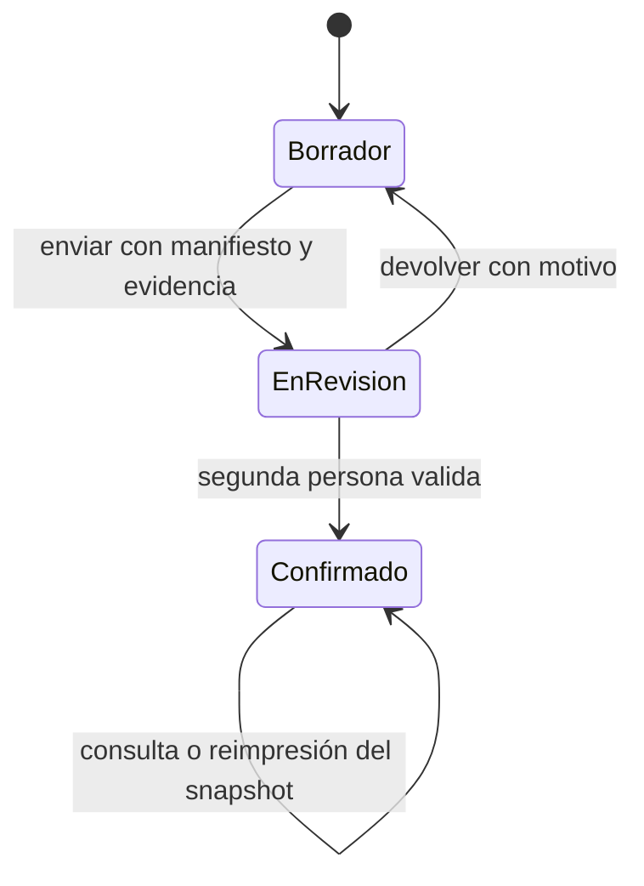

# Permisos flujo de corte y decisiones pendientes

## Qué cambia y qué permanece

Las reglas confirmadas permanecen: identidad vinculada, un único cargo activo, cargos anteriores conservados, comité activo, territorio limitado y responsable sin modificación del padrón. La preparación/revisión de caja es una capacidad contextual de la responsabilidad vigente, no un segundo cargo simultáneo.

En la consolidación, Secretaría no obtiene Tesorería automáticamente. El nuevo requisito permite que consulte balances/reportes comunitarios **autorizados**: se propone una concesión de agregados `consultar_balance_agregado`, separada tanto del permiso central de consultar datos financieros individuales como de operar/cobrar. Así puede supervisar cifras sin abrir expedientes financieros personales. Es una propuesta de implementación, no un permiso ya creado.

Ningún permiso vigente de presidente, tesorero u operación financiera central implica automáticamente aprobar cortes. Añadir capacidades estrechas para preparar, revisar, confirmar, registrar movimientos de custodia y gestionar diferencias. Reutilizar grupos/permisos Django y las funciones de alcance existentes; no crear un sistema de cargos paralelo. Validar todo en servicios y selectores.

## Matriz propuesta

“Concesión” exige habilitación expresa y alcance correcto; no constituye aprobación ya dada por el cliente.

| Perfil | Balance agregado | Detalle individual | Cobrar | Preparar corte | Revisar/confirmar | Rectificar | Compartir |
|---|---|---|---|---|---|---|---|
| Secretaría | Comunidad con concesión de agregado | Concesión financiera central vigente | Concesión financiera operativa actual; evaluar permiso limitado de cobro en otra entrega | Concesión específica, caja autorizada | Concesión específica, persona distinta del preparador | Procedimiento y facultad expresos | Informes autorizados y agregados |
| Presidente | Comité activo | Comité según política actual | Comité según política actual | Concesión específica | Concesión específica, segunda persona | Concesión específica | Solo ámbito autorizado |
| Tesorero | Comité activo | Comité según política actual | Comité según política actual | Concesión específica | Concesión específica, segunda persona | Concesión específica | Solo ámbito autorizado |
| Solo lectura | Ámbito de su comité | Lo que permite hoy su rol, sin ampliación por reporte | No | No | No | No | Impresión/CSV/enlace autorizado; cortes confirmados de su ámbito |
| Responsable manzana | Su conjunto financiero autorizado | Concepto MANZANA propio y ciudadano actualmente dentro del alcance | Igual restricción; nunca conceptos generales | No automático; solo si se habilita caja exclusivamente territorial y permiso específico | No por ser responsable | No por ser responsable | Reportes territoriales permitidos |
| Administración técnica | No se identifica con revisor financiero | Mantiene acceso técnico actual; no ampliar por nuevo módulo | No nuevo derecho de negocio por ser técnico | Solo si cuenta además con habilitación de negocio | No aprobación automática | No aprobación automática | No publicación automática |

El superusuario ya tiene alcance técnico amplio en el código existente. La propuesta de confirmación debe exigir identidad y habilitación financiera explícita, incluso para quien tiene superusuario. `has_perm` por sí solo no acredita esa concesión expresa para un superusuario porque Django lo satisface globalmente; el servicio deberá verificar las asignaciones explícitas de permisos/grupos, además de la responsabilidad y el recurso. Esta regla nueva necesita aprobación y pruebas: no está implementada ni altera hoy las cuentas existentes.

## Consulta territorial frente a cierres históricos

Las consultas vivas de responsables siguen `limitar_finanzas`: tras una mudanza no incluyen la obligación ni sus abonos fuera de los criterios actuales. Un corte confirmado no puede variar sus cifras por esa mudanza. Por eso:

- La versión oficial completa del cierre solo se muestra a un ámbito que autorice todo el manifiesto (autoridad financiera del comité/central).
- Un responsable sin ese ámbito no obtiene automáticamente el cierre completo ni su detalle por conocer un UUID o haber cobrado alguna fila.
- Un reporte parcial filtrado para su autorización actual se etiqueta “consulta territorial actual, no total oficial del corte”; no se presenta como snapshot oficial ni se usa para reescribirlo.
- Un informe agregado histórico de manzana que incluya ciudadanos trasladados requiere una política explícita adicional de transparencia/privacidad. Hasta aprobarla, no se habilita a responsables por defecto. Los conceptos generales no pasan a su ámbito porque un informe mezcle recursos.

Las pantallas de prototipo usan agregados ficticios y no prueban autorización real. En implementación, el HTML, las gráficas y el CSV deben partir del mismo selector autorizado; nombres de cajas/comités ajenos no se ofrecen en filtros.

## Estados mínimos de corte

“Con diferencia pendiente” es una condición ortogonal, no un estado que reemplaza al cierre: un corte puede estar EN_REVISION con diferencia; si se permite confirmar con diferencia, conservar `diferencia != 0`, explicación y seguimiento sin cambiar los importes. “Rectificado” es una relación/indicador del original hacia un documento sucesor; el original sigue confirmado. Esto evita un número excesivo de estados y deja visible quién confirmó qué.

Propuesta conservadora mientras no exista decisión: diferencia distinta de cero bloquea confirmación; puede enviarse a revisión con explicación, pero no aparece como cuadrada. Si no hay segunda persona disponible, mantenerlo pendiente y documentar revisión posterior; no habilitar autoaprobación silenciosa. La excepción de una sola persona requiere política explícita antes de implementarla.

El prototipo permite enviar un faltante explicado y mantiene bloqueada la confirmación mientras no sea cero. Ilustra el flujo conservador, no decide la política definitiva del cliente.

## Decisiones para autorizar implementación

| ID | Decisión de negocio | Propuesta para evaluar | Bloquea |
|---|---|---|---|
| D01 | ¿Ingresos/cortes o contabilidad con egresos? | Opción A para MVP; B separada | Alcance general |
| D02 | ¿Qué significa “caja”: persona, comité, ventanilla o territorio? | Unidad de custodia por comité, manzana opcional; Secretaría puede operar varias | Medios/cajas |
| D03 | ¿Quién conserva y entrega efectivo? ¿Cuándo se deposita? | Registrar aperturas, todas las salidas y comprobantes; decidir si se permiten gastos directos de caja con evidencia mínima o solo entregas/traslados | Conciliación real |
| D04 | ¿Qué puede hacer Secretaría con dinero? | Agregados para supervisión autorizada; consulta individual/cobro/preparación/aprobación separados | Permisos y UI |
| D05 | ¿Quién prepara y quién revisa cada caja? | Tesorero/preparador y presidente/revisor como candidatos, con concesión expresa, sin asignarlo automáticamente por cargo | Cierres |
| D06 | ¿Se puede confirmar con faltante/sobrante? ¿Quién da seguimiento? | Bloquear salvo regla expresa posterior con evidencia y aceptación distinta | Confirmación con diferencias |
| D07 | ¿Qué ocurre si solo hay un operador? | Pendiente de revisión posterior; excepción solo documentada y aprobada | Operación en comunidades pequeñas |
| D08 | ¿Transferencia informada equivale a cobro confirmado? | Separar declarada y verificada; pendientes no son efectivo y no se presentan como conciliadas | Medios/cierres |
| D09 | ¿Periodicidad y zona de cierres? | Por caja e intervalo de captura; decidir tratamiento de efectivo recibido antes y capturado después, sin sumarlo dos veces; America/Mexico_City | Cierres/retroactivos |
| D10 | ¿Se bloquea eliminación/edición de fuentes cerradas? | Sí, todas las rutas; corrección mediante documento sucesor | Cualquier cierre confiable |
| D11 | ¿Cómo se rectifican importes ya cerrados? | Rectificación vinculada e historial íntegro, sin falsificar Abonos; procedimiento detallado posterior | Rectificaciones |
| D12 | ¿Pago/Cooperacion anteriores se incorporan? | Solo informe separado; integración tras conciliación y evidencia | Totales históricos integrales |
| D13 | ¿Desde cuándo se inicia control de caja? | Fecha de adopción y apertura inventariada, sin asumir medio histórico | Primer corte |
| D14 | ¿Qué datos reciben lectores y responsables de relevo? | Ámbitos vigentes; histórico oficial solo con autorización íntegra; privados por defecto | Transparencia histórica |
| D15 | ¿Cuándo suprimir grupos pequeños? ¿Cuánto guardar comprobantes? | Política de mínimos y retención antes de compartir | Informes/evidencia |
| D16 | ¿Se requiere PDF institucional fijo/firma? | HTML imprimible primero; referencia/hash verificables, sin llamarlos firma digital | PDF/versiones |

Decisiones D01, D04 (agregados), D12 y metodología temporal permiten iniciar las dos primeras fases. Las demás pueden resolverse antes de su fase dependiente; no se requiere implementarlas simultáneamente. No hay publicación abierta ni sistema contable general autorizado por este documento.
